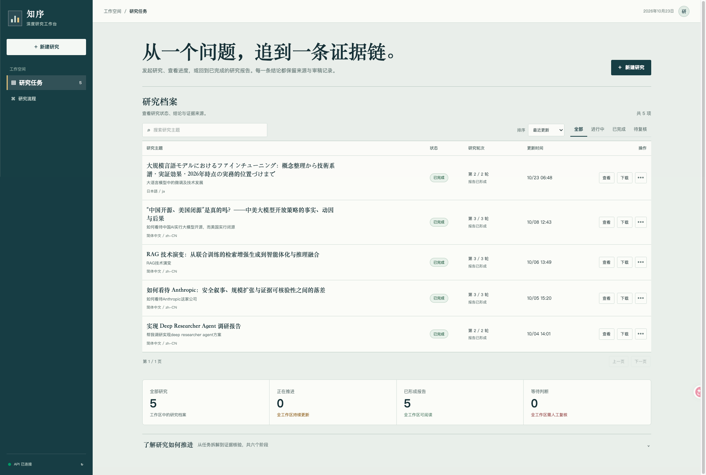
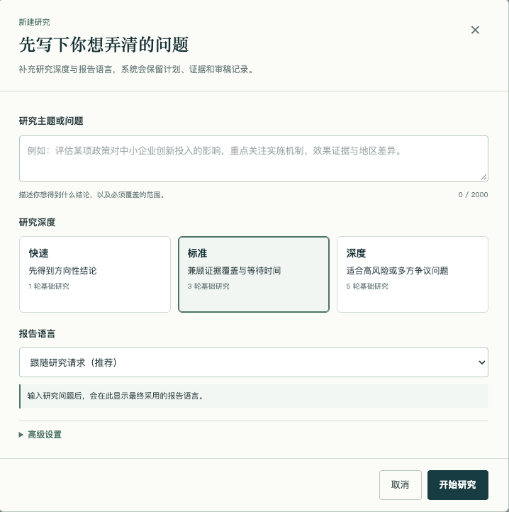
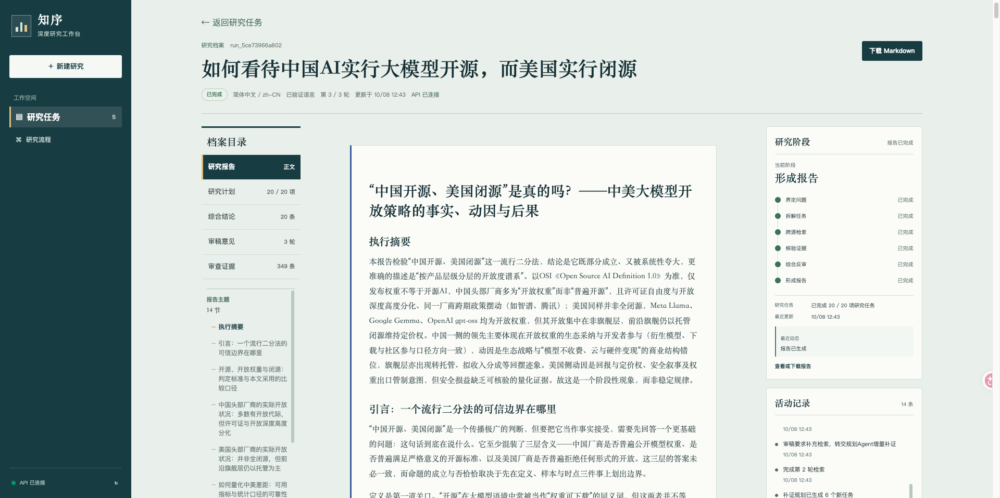
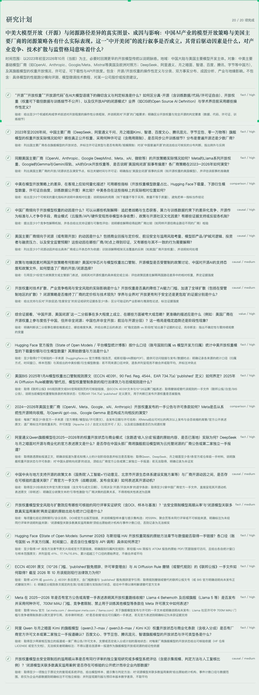
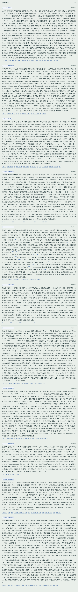
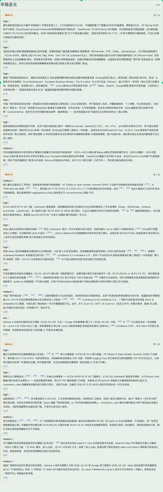
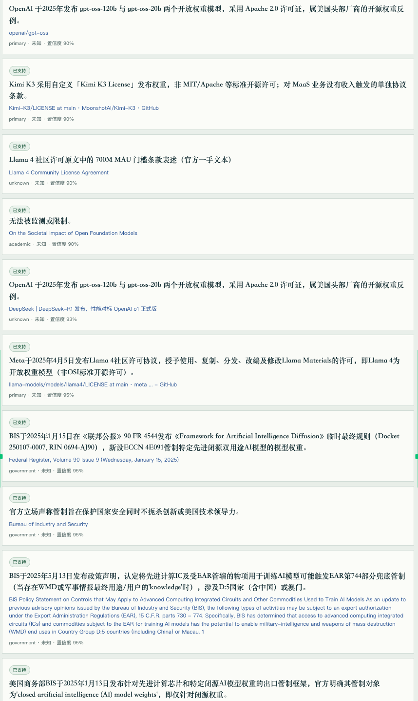

# Deep Research Agent

<div align="center">


**知序 · 从研究问题到可追溯报告的多 Agent 工作台**

FastAPI · Vue 3 · LangChain · SQLite

</div>

---

## 项目介绍

Deep Research Agent 是一个本地优先的深度研究工作台。用户提交研究问题后，系统通过多 Agent 流水线完成研究规划、并行网络检索、证据审查、结论综合、批判复审和报告写作，并生成一份带可点击引用的 Markdown 报告。

与单次模型调用不同，这里使用确定性状态机协调多个受限 Agent。计划、任务、证据、结论、审稿意见、报告块和运行事件都会保存到 SQLite，因此研究任务可以在暂停、服务停止或进程中断后继续执行。

### 界面预览

**研究任务首页**



**新建研究主题任务**



**研究报告详情页**



**研究计划**



**综合结论**



**审稿意见**



**审查证据**


## 核心能力

- **多 Agent 研究**：Planner、Researcher、Evidence Reviewer、Synthesizer、Critic 和 Writer 分别承担受限职责。
- **证据链可追溯**：结论和报告引用都关联到证据卡片与来源 URL，避免凭空生成结论。
- **批判复审**：Critic 发现证据不足时，会回到 Planner 生成增量补证任务，而不是直接改写结论。
- **断点续跑**：每个状态迁移都会保存检查点，任务可在暂停或服务重启后从最近阶段恢复。
- **实时进度**：通过 Server-Sent Events 推送研究事件，前端同时保留增量轮询兜底。
- **多搜索源**：默认使用 DuckDuckGo；配置 API Key 后可叠加 Tavily、Parallel、You.com 和 Exa。
- **结构化写作**：Writer 按大纲、分章、摘要三阶段生成报告，并对引用 ID 做存在性校验。
- **任意主题**：Planner 自动识别一个或多个研究领域；医疗、法律、金融和公共安全主题自动采用更严格的证据标准。
- **多语言报告**：研究请求可输入任意语言，报告语言默认跟随请求并可在创建时覆盖；检索可跨语言，来源标题与原文摘录保持原语言。
- **RTL 与语言门禁**：报告支持从右到左的书写方向；最终报告和追问回答经过目标语言校验，必要时自动重写一次。
- **上下文预算**：进入模型的内容会压缩、去重并按 token 预算装箱，原始全文不会直接进入提示词。

## 技术栈

| 层级 | 技术 |
| --- | --- |
| 后端 | Python 3.12+、FastAPI、Uvicorn、Pydantic v2、LangChain |
| 数据存储 | SQLAlchemy 2、SQLite，默认 `backend/data/research.db` |
| LLM 接入 | OpenAI 兼容 API，`langchain-openai` |
| 前端 | Vue 3、Vite、Pinia、Tailwind CSS v4、Marked、DOMPurify |
| 进度通信 | 后台任务、SSE、增量轮询 |

## 快速开始

### 环境要求

- Python 3.12 或更高版本
- [uv](https://docs.astral.sh/uv/)
- Node.js 20 或更高版本
- npm 10 或更高版本
- 一个 OpenAI 兼容模型服务的 Base URL、API Key 和模型名称

### 配置后端

```bash
cp backend/.env.example backend/.env
```

编辑 `backend/.env`，至少填写：

```dotenv
LLM_MODEL=your-model-name
LLM_API_KEY=your-api-key-here
LLM_BASE_URL=https://your-openai-compatible-base-url
```

> [!IMPORTANT]
> 这三项是后端启动的必需配置。模型网关如果不支持 function calling，可将 `USE_TOOL_CALLING=false`，系统会改用 JSON Schema 生成结构化输出。

### 启动后端

```bash
uv sync --project backend
uv run --project backend uvicorn backend.main:app --reload --host 127.0.0.1 --port 8000
```

常用入口：

- Swagger 文档：<http://127.0.0.1:8000/docs>
- 健康检查：<http://127.0.0.1:8000/api/health>

### 启动前端

```bash
cd frontend
npm install
npm run dev
```

打开 <http://127.0.0.1:3000>。Vite 会把 `/api` 请求代理到 `http://127.0.0.1:8000`。

如需修改前端端口或后端地址，可在 `frontend/.env` 中设置：

```dotenv
VITE_PORT=3000
VITE_API_BASE_URL=http://127.0.0.1:8000
```

## 配置项

常用环境变量如下，完整示例见 [`backend/.env.example`](backend/.env.example)。

| 变量 | 说明 |
| --- | --- |
| `LLM_MODEL` | 模型名称 |
| `LLM_API_KEY` | OpenAI 兼容服务的 API Key |
| `LLM_BASE_URL` | OpenAI 兼容服务的 Base URL |
| `USE_TOOL_CALLING` | 是否使用 function calling，默认 `true` |
| `CORS_ORIGINS` | 逗号分隔的浏览器来源列表 |
| `HOST` / `PORT` | API 服务监听地址和端口 |
| `RESEARCH_DB_URL` | 研究数据库连接地址，默认 SQLite |

可选搜索源配置：

```dotenv
# TAVILY_API_KEY=tvly-xxxxx
# PARALLEL_API_KEY=parallel-xxxxx
# YDC_API_KEY=xxxxx
# EXA_API_KEY=xxxx
```

只要配置了对应 Key，相应搜索源会自动加入检索 Agent。

## 研究流程

1. **提出问题**：填写研究主题和最大迭代次数。
2. **规划任务**：Planner 生成研究问题、范围约束和可执行检索任务。
3. **并行检索**：Researcher 生成查询，调用多个搜索源，抓取并去重候选材料。
4. **证据审查**：Evidence Reviewer 保留 `supported` 或 `partially_supported` 的证据。
5. **结论综合**：Synthesizer 生成带 ID、置信度和限制说明的研究结论。
6. **批判复审**：Critic 检查结论质量；需要补证时回到 Planner 增量规划。
7. **报告写作**：Writer 基于 Critic 批准的结论生成 Markdown 报告，并校验引用。

达到 `max_iterations` 后，系统会停止补证，只使用当前已批准的结论写作。如果没有可用结论，任务进入 `needs_human_review`。

| Agent | 职责 |
| --- | --- |
| Planner | 分解研究问题，按审稿意见做增量补证规划 |
| Researcher | 并发检索网页，筛选候选证据 |
| Evidence Reviewer | 判断候选证据是否支持任务要求 |
| Synthesizer | 将通过审查的证据综合为研究结论 |
| Critic | 复审结论，决定通过、补证或人工复核 |
| Writer | 按三阶段流程写作并校验报告引用 |

## API 概览

| 方法 | 路径 | 说明 |
| --- | --- | --- |
| `GET` | `/api/health` | 健康检查 |
| `POST` | `/api/research-runs` | 创建并启动研究任务 |
| `GET` | `/api/research-runs` | 分页、搜索和按状态筛选任务 |
| `GET` | `/api/research-runs/{run_id}` | 获取计划、证据、结论、审稿和报告 |
| `GET` | `/api/research-runs/{run_id}/progress` | 增量轮询状态和事件 |
| `GET` | `/api/research-runs/{run_id}/events` | 订阅 SSE 实时事件流 |
| `GET` | `/api/research-runs/{run_id}/references/{reference_id}` | 解析报告引用 ID |
| `GET` | `/api/research-runs/{run_id}/report.md` | 下载 Markdown 报告 |
| `POST` | `/api/research-runs/{run_id}/cancel` | 取消运行中的任务 |
| `POST` | `/api/research-runs/{run_id}/resume` | 恢复已暂停或中断的任务 |
| `DELETE` | `/api/research-runs/{run_id}` | 删除任务及其关联数据 |

创建任务的示例：

```bash
curl -X POST http://127.0.0.1:8000/api/research-runs \
  -H "Content-Type: application/json" \
  -d '{
    "user_request": "比较 RAG 与长上下文模型在企业知识管理场景中的适用性",
    "report_language": "en",
    "max_iterations": 3
  }'
```

`report_language` 可省略，此时系统根据 `user_request` 推断报告语言；模糊时回退到工作台界面语言 `zh-CN`。支持 BCP 47 标签和常见语言名称。中文、英文、日文、西班牙文和阿拉伯文为已验证语言，其他合法书面语言按尽力支持运行。

主要任务状态包括 `planning`、`researching`、`reviewing_evidence`、`synthesizing`、`critic_review`、`writing`、`paused`、`completed`、`needs_human_review`、`failed` 和 `cancelled`。

## 命令行模式

除 Web UI 外，也可以直接运行一次研究并导出结果：

```bash
uv run --project backend python backend/scripts/research_topic_output.py "你的研究主题" 3 en
```

第二个参数是最大迭代次数，默认为 `3`；第三个参数是可选的报告语言，省略时自动推断。脚本会在 `backend/resources/` 下生成完整运行记录 `result_*.txt` 和 Markdown 报告 `report_*.md`。

## 任务生命周期

- 创建任务后，研究在 FastAPI 进程内的后台任务中执行，页面关闭不会终止任务。
- 用户暂停、服务正常停止或进程异常退出时，未完成任务会保存为 `paused`。
- 恢复时使用最近保存的计划、任务、证据、结论、审稿意见和事件继续执行。
- 如果进程在模型或搜索调用尚未完成时被强制停止，恢复时可能重新执行当前阶段。
- 达到初始轮次上限但没有可写作的已批准结论时，系统自动增加 1 轮并回到增量补证；若补证规划无法产生新任务，则停止空转并进入人工复核。
- 完成任务可下载报告；已取消、失败或需要人工复核的任务不会继续写入报告。
- 报告语言在创建任务后固定；恢复、补证和追问沿用该语言，切换语言需要创建新任务。
- 最终报告或追问回答未通过已验证语言校验时，系统先执行一次定向重写；仍未通过则报告进入人工复核或追问返回失败。

## 项目结构

```text
.
├── backend
│   ├── main.py                     # FastAPI 应用入口
│   ├── src/api                     # REST API、SSE 和请求 Schema
│   ├── src/research                # Agent、编排器、提示词、上下文预算
│   ├── src/services                # LLM 客户端和搜索适配器
│   ├── src/storage                 # SQLAlchemy 模型和仓储层
│   └── tests                       # 后端测试
├── frontend
│   ├── src/components              # 报告、任务列表、流程图、引用弹窗等
│   ├── src/stores/research.js      # Pinia 状态管理
│   └── src/lib                     # API 客户端与 Markdown 工具
└── docs/images                     # README 界面截图
```

## 测试

运行后端测试：

```bash
uv run --project backend pytest
```

运行前端测试：

```bash
cd frontend
npm test
```

## 部署提示

默认执行模型是进程内后台任务加本地 SQLite，适合单机部署和个人研究工作台。

> [!NOTE]
> 多 worker 或多实例部署需要共享任务队列、共享数据库和实例间事件通知机制；当前实现未内置这些能力。

生产部署时建议把 `CORS_ORIGINS` 收敛到实际前端域名，并通过密钥管理系统注入模型和搜索服务 API Key。长任务会产生多次模型和搜索请求，请根据服务配额控制 `max_iterations`。
